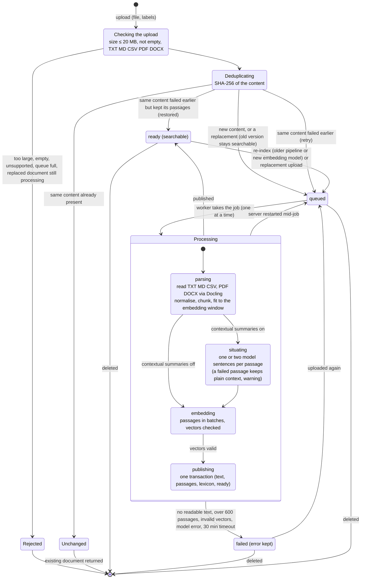
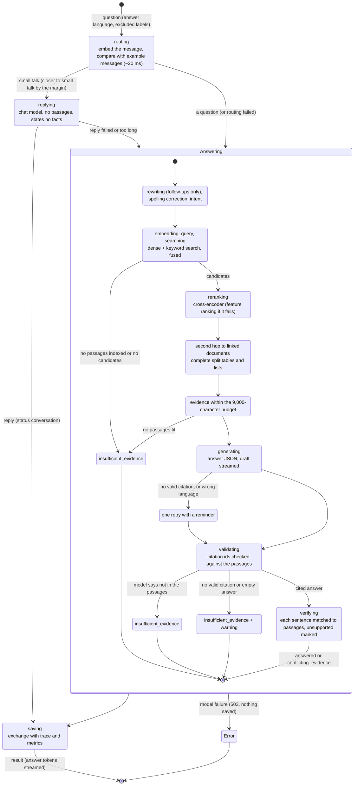

# State machines

Drawn from the code: how a document goes from upload to searchable, and how a question becomes an
answer. Lower-case state names are the stage names the app shows while the work runs. A rendered
version with a table per state is in `state-machines.html`.

## Document processing

| State | What happens | Shown in the app | Code |
|---|---|---|---|
| Checking | Size up to 20 MB, not empty, a supported type (TXT, Markdown, CSV, PDF, DOCX); the queue has room; a replaced document is not mid-processing. | rejected with 400, 409, 413 or 429 | `ingestion/intake.py upload` |
| Deduplicating | SHA-256 of the content. Same content already present returns that document; same content that failed but kept its passages is restored; otherwise the file is stored and queued. A replacement is staged so the old version stays searchable until the new one is published. | queued | `ingestion/intake.py upload` |
| queued | Waiting for the single worker (bounded queue of 32). Interrupted jobs return here when the server restarts; re-indexing (older pipeline, new embedding model) also queues here. | queued | `pipeline/indexing.py worker, store/documents.py requeue_interrupted` |
| parsing | Read the text (PDF and DOCX through Docling), normalise it, cut it into passages at headings and sentence ends, and split any passage longer than the embedding window. No readable text or more than 600 passages fails the job. | parsing | `ingestion/parser.py, ingestion/chunker.py, pipeline/indexing.py build` |
| situating | One or two model-written sentences per passage placing it in its document (searched with it). A passage whose summary fails keeps its plain context and the document gets a warning. | situating (n of total) | `ingestion/situate.py` |
| embedding | Embed the passages in batches; vectors of the wrong size or with invalid numbers fail the job. | embedding (n of total) | `pipeline/indexing.py build` |
| publishing | One transaction: document text, passages (replacing the old ones), spelling lexicon, status ready. | publishing | `pipeline/indexing.py publish` |
| ready | Searchable. Leaves only for re-indexing, a replacement upload or deletion. | ready | `store/documents.py mark_ready` |
| failed | The error is kept on the document. Uploading the same file again retries it. A job that runs past 30 minutes also ends here. | failed | `pipeline/indexing.py process, worker` |

## Question answering

| State | What happens | Shown in the app | Typical time (p50) | Code |
|---|---|---|---|---|
| routing | Embed the message and compare it with the small-talk and question examples (generation/smalltalk.toml). | routing | 0.02 s | `generation/smalltalk.py route_score` |
| replying | Small talk only: the chat model writes one or two sentences, sees no passages and states no facts. Status conversation. | replying | 1.1 s | `generation/smalltalk.py small_talk_reply` |
| understanding | Follow-ups are rewritten into a standalone question using the conversation; spelling is corrected from the corpus vocabulary; the intent (lookup, relationship, overview) is classified. | rewriting (follow-ups) | 1.0 s for follow-ups, otherwise under 0.1 s | `retrieval/analyzer.py analyze` |
| searching | Embed the question; dense and keyword search; the two rankings fused. | embedding_query, searching | under 0.1 s | `retrieval/search.py retrieve` |
| reranking | A cross-encoder scores 30 candidates against the question; if it fails, ranking falls back to features. | reranking | 2.9 s | `retrieval/search.py, llm/ollama.py relevance` |
| second hop and budget | Names in the best passage pull in passages from other documents; split tables and lists are completed; the best passages are kept within the 9,000-character evidence budget. | (part of searching) | under 0.1 s | `retrieval/hop.py, retrieval/structure.py, reasoning/evidence.py` |
| generating | The answer model writes JSON (answer, citation ids, status); the answer text streams to the app as a draft. One retry with a reminder if no citation is valid or the answer is in the wrong language. | generating | 4.2 s | `generation/answer.py, generation/prompt.py` |
| validating | Citation ids are checked against the passages actually shown. A model that says the passages do not answer gives insufficient_evidence; an answer with no valid citation is withheld with a warning. | validating | under 0.1 s | `generation/answer.py generate_answer` |
| verifying | Each sentence of a cited answer is matched to the passages that state it; citations are completed and unsupported sentences marked. Answered or conflicting_evidence. | verifying | 3.3 s | `generation/attribution.py` |
| saving | The question and answer are saved with the trace and metrics, then the validated answer is sent. A model failure anywhere before this returns 503 and saves nothing. | streaming | under 0.1 s | `pipeline/querying.py chat, api/chat.py` |

Statuses an answer can end with: `answered`, `conflicting_evidence`, `insufficient_evidence`,
`conversation`. Typical times are from `docs/reports/response-time.md`.
